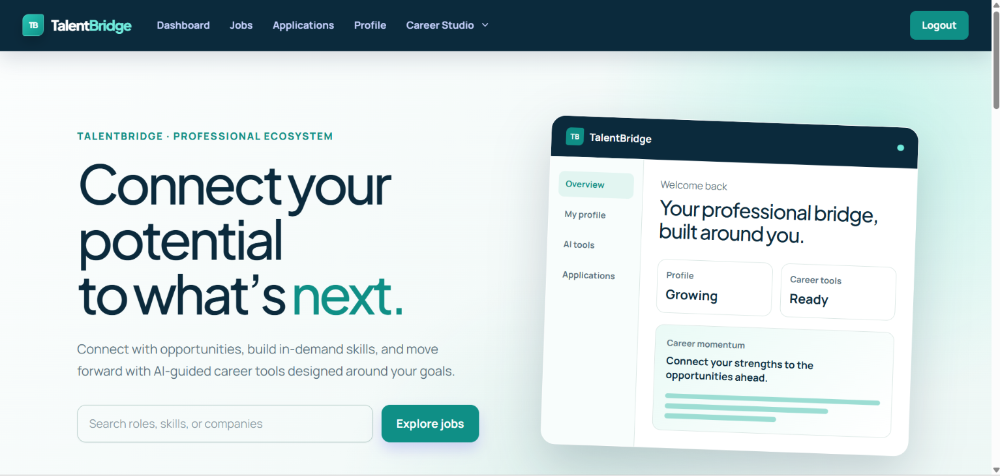
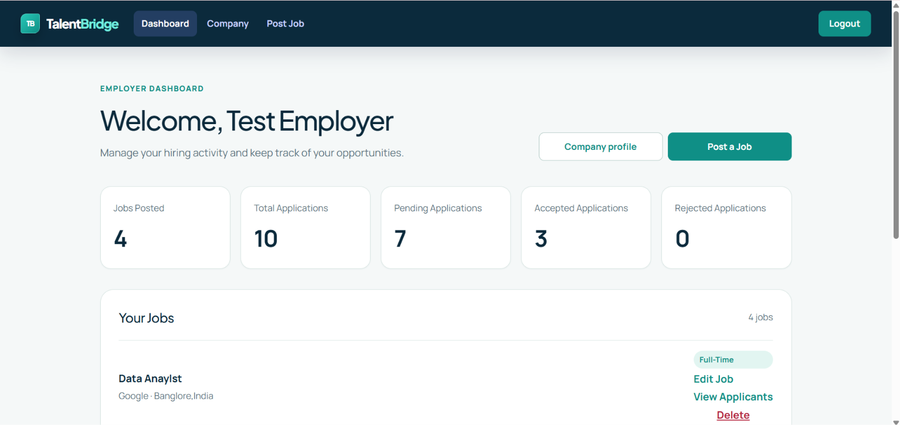
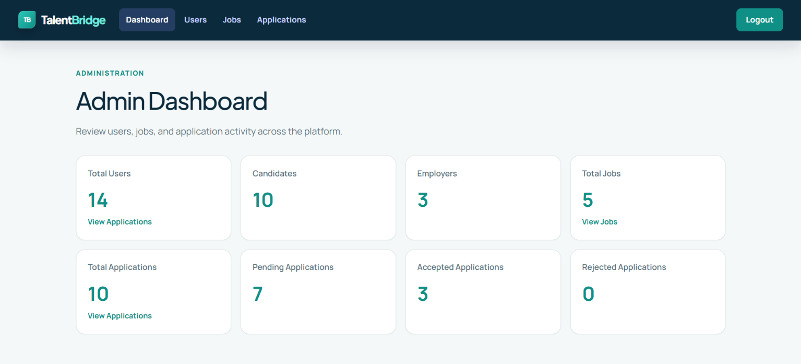
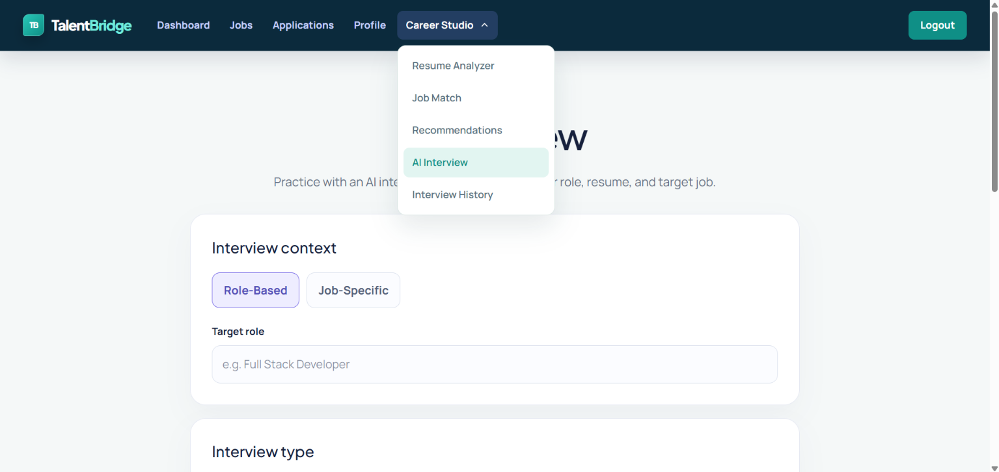
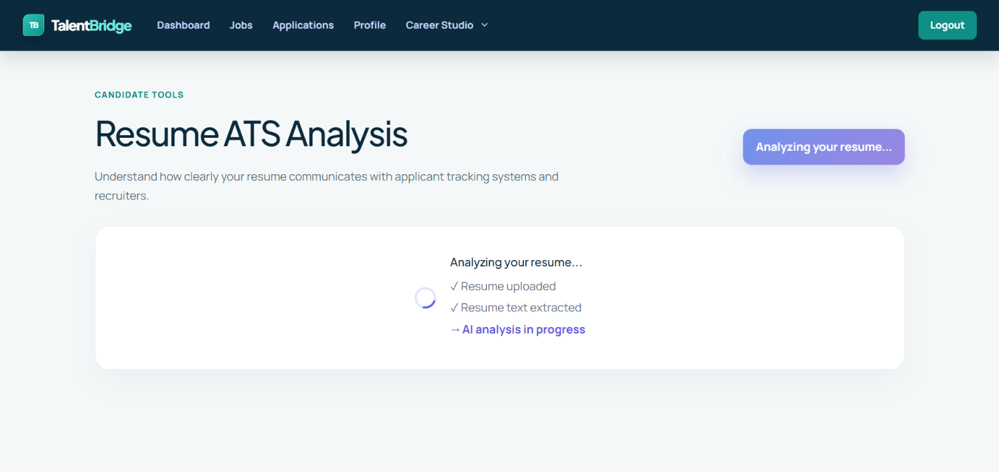
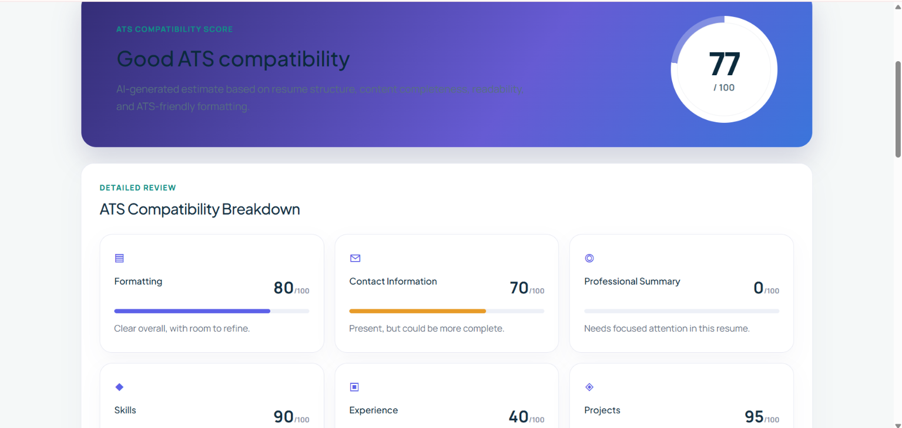
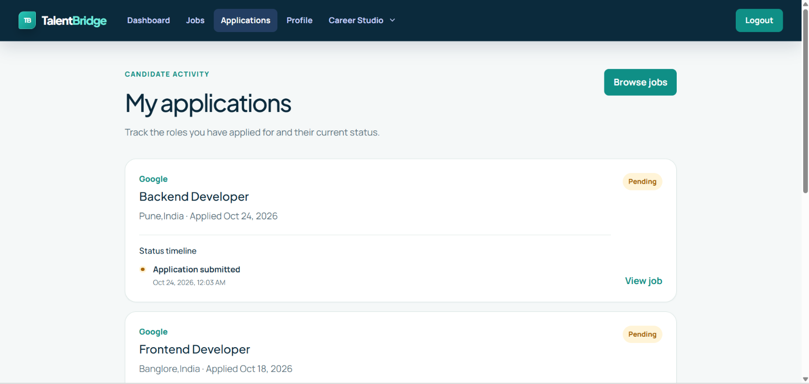
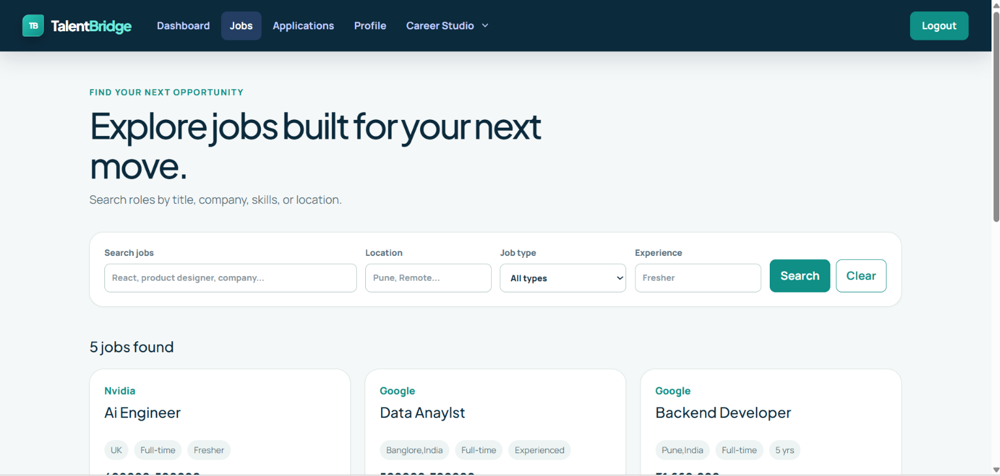

# TalentBridge

**Connect. Learn. Grow. Succeed.**

TalentBridge is a professional ecosystem that brings career opportunities, recruitment workflows, professional development, and AI-powered career tools into one focused experience.

## What it includes

- Candidate profiles, job discovery, applications, recommendations, resume analysis, job matching, and AI interview practice.
- Employer company profiles, job management, applicant review, and hiring analytics.
- Administrative moderation, user management, and application oversight.
- A FastAPI AI service for resume analysis, job matching, and interview workflows.

## Architecture

| Area | Technology |
| --- | --- |
| Web app | React 19, Vite, Redux Toolkit, React Router, Tailwind CSS |
| API | Node.js, Express, MongoDB, Mongoose, JWT |
| AI service | Python, FastAPI, Gemini |

## Local development

Create local environment files from the examples in `Client`, `Server`, and `AIService`. Keep secrets out of source control.

```text
cd Server && npm start
cd AIService && uvicorn main:app --host 0.0.0.0 --port 8000
cd Client && npm run dev
```

## Environment Variables and Configuration

Each service has an `.env.example` template. Copy the relevant template to a
local `.env` file before running that service, then replace its placeholders
with credentials and settings from your own accounts. Never commit real
credentials or local `.env` files to Git.

### Server

Configure these variables in `Server/.env` using `Server/.env.example` as the
template:

| Variable | Purpose |
| --- | --- |
| `MONGODB_URI` | MongoDB connection configuration. |
| `JWT_SECRET` | Secret used to sign authentication tokens. |
| `CLOUDINARY_CLOUD_NAME` | Cloudinary account identifier. |
| `CLOUDINARY_API_KEY` | Cloudinary API credential identifier. |
| `CLOUDINARY_API_SECRET` | Cloudinary API secret. |
| `FRONTEND_URL` | Allowed frontend origin for the API. |
| `NODE_ENV` | Runtime environment indicator. |
| `PORT` | Port for the API server. |

### AIService

Configure these variables in `AIService/.env` using `AIService/.env.example`
as the template:

| Variable | Purpose |
| --- | --- |
| `AI_SERVICE_API_KEY` | API key used to authorize requests to the AI service. |
| `GEMINI_API_KEY` | Credential for Gemini API access. |
| `GEMINI_MODEL` | Gemini model identifier to use. |

Gemini API usage may incur charges depending on your account and usage. Review
your provider's pricing and usage controls before enabling it.

### Client

Configure this variable in `Client/.env` using `Client/.env.example` as the
template:

| Variable | Purpose |
| --- | --- |
| `AI_SERVICE_URL` | Base URL used by the client to reach the AI service. |

## Quality checks

```text
cd Server && npm test
cd Client && npm run lint && npm run build
cd AIService && python -m unittest test_main
```

For deployment and test-environment guidance, see [docs/RELEASE_READINESS.md](docs/RELEASE_READINESS.md).

## Screenshots

### Product home and dashboards







### AI-powered tools










